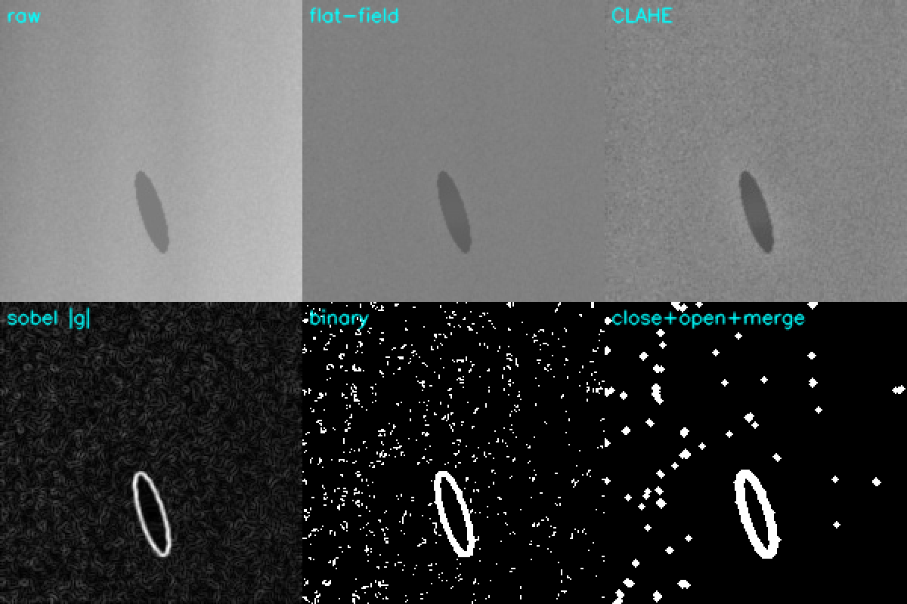
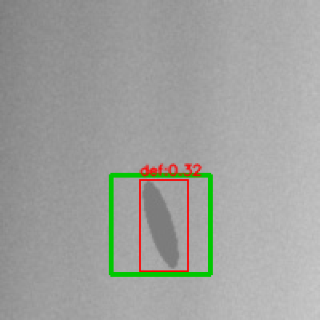

# 热轧带钢表面缺陷检测：传统图像处理基线 vs 滑窗小 CNN

NEU-DET 六类缺陷，两条**不依赖大模型**的检测路线，用同一套工业口径（漏检率 / 过杀数 / 单图延迟）比较。

这个仓库的重点不是刷 mAP，而是回答三个在产线上真会被问的问题：

1. **传统图像处理能做到什么程度，什么时候必须上深度学习？**
2. **评估一个检测器，除了 mAP 还要看什么？**（漏检一条 = 一次质量事故；过杀一次 = 一次停机复核）
3. **算力受限、只能部署分类网络时怎么办？**（滑窗 + 小 CNN 是现场真实存在的路线，不是偷懒）

---

## 1. 数据

[NEU-DET](http://faculty.neu.edu.cn/yunhyan/NEU_surface_defect_database.html)（东北大学热轧带钢表面缺陷库）：6 类、共 1800 张 200×200 灰度图，VOC 格式标注。

```
data/NEU-DET/
├── IMAGES/        # *.jpg
└── ANNOTATIONS/   # *.xml（VOC bndbox）
```

| 类别 | 含义 | 传统方法的难点 |
|---|---|---|
| crazing | 细密裂纹网 | 对比度极低，梯度阈值直接淹在噪声里 |
| inclusion | 条状夹杂 | 与轧制方向纹理同向，容易和条纹混淆 |
| patches | 大面积斑块 | 面积大、边界模糊，容易被面积规则过滤掉 |
| pitted_surface | 密集麻点 | 小目标 + 数量多，连通域会被拆成一堆碎点 |
| rolled-in_scale | 氧化皮压入 | 边界抖动，形状不规则 |
| scratches | 划痕 | 方向和纹理相近，容易过杀 |

没有数据也能跑通全流程：`scripts/run_all.py` 会先用合成数据（同样的六类、同样的 200×200、同样的 VOC 结构）把管线跑一遍。
**合成数据只证明管线正确，不代表真实精度** —— 下面所有数字都标了数据来源。

---

## 2. 两条路线

### A. 传统图像处理基线（零训练、零参数学习）

`src/preprocess.py` 里每一步都能被追问"为什么是这一步"：

```
灰度 → flat-field（大核中值做背景估计后相除，先干掉光照不均）
     → CLAHE（局部对比度拉伸，专门救低对比度缺陷）
     → 高斯（抑制传感器噪声，别让噪声变成边缘）
     → Sobel 幅值（缺陷的本质是局部灰度突变）
     → 阈值（Otsu 或分位数，二值化）
     → 闭运算（连断裂）→ 开运算（去孤立噪点）→ 膨胀（把同一缺陷的碎片并成一组）
     → 连通域 → 面积 / 填充率 / 长宽比 规则筛选
     → 输出框 + 分数（框内平均梯度 / 全图梯度 p99.5，用于阈值扫描）
```

参数不在 val 上调：`--mode tune` 只在 **tune 集**上网格搜索（72 组），best 参数落盘，val 只用来报数。

### B. 滑窗 + 小 CNN（`src/patches.py` → `src/cnn_model.py` → `src/slide_infer.py`）

把检测降维成 patch 二分类：

```
训练：按 GT 采样正/负 patch（含"贴着缺陷边缘"的 hard negative）→ 0.29M 参数的小 CNN
推理：滑窗打分（stride 可调）→ 分数热力图 → 阈值 → 连通域 → 合并 → NMS → 框
```

- 网络：4 层卷积 + BN + 全局池化，0.29M 参数，**纯 CPU 可训可推**；
- 采样：每张图 6 正 / 10 负，一半负样本贴着 GT 边缘采（教模型学边界而不是背景纹理）；
- 数据增强：翻转、±8° 旋转、亮度/对比度抖动、高斯噪声 —— 工业图像里"光照偏移"才是最真实的域偏移。

**为什么不用 YOLO？** 因为现场经常只有"分类网络能上"的条件（推理框架只支持分类算子、NPU 工具链限制、模型要过安全审查）。这条路线能把"算力受限"这个约束显式地摊在桌上：**精度换延迟，且延迟与窗口数成正比**。

---

## 3. 结果（合成数据，仅验证管线）

数据：72 张合成图（6 类 × 12），train/tune/val = 48/12/12，IoU=0.5，6 类缺陷统一按 `defect` 一类评估
（`src/common.py` 的 `norm_cls`；工业检测里"有没有缺陷"比"是哪种缺陷"优先级更高，原因见第 9 节）。

| 方法 | mAP@0.5 | 最差类 AP | 召回 | 漏检率 | 图级漏检 | 过杀/图 | P50 (ms) |
|---|---|---|---|---|---|---|---|
| 传统基线（零训练） | **0.294** | 0.294 | 0.40 | 0.60 | 0.58 | 0.42 | **14.5** |
| 滑窗 + 小 CNN（stride 32） | 0.152 | 0.152 | 0.27 | 0.73 | 0.67 | 0.67 | 353 |

延迟分解（PyTorch CPU，4 线程，200×200 单图）：

| 阶段 | P50 | P95 | P99 |
|---|---|---|---|
| 传统基线 · 全流程 | 14.5 | 27.3 | 27.7 |
| 滑窗 CNN · 预处理（灰度+pad） | 2.2 | 3.2 | 3.4 |
| 滑窗 CNN · 前向（36 个窗口） | 349.4 | 392.8 | 409.9 |
| 滑窗 CNN · 后处理（连通域+NMS） | 0.8 | 1.6 | 1.8 |

### 3.1 精度-延迟权衡：改 stride 就是改窗口数

| stride | 窗口数/图 | mAP@0.5 | 召回 | 漏检率 | 延迟 (ms) |
|---|---|---|---|---|---|
| 8 | 324 | 0.186 | 0.33 | 0.67 | 4036 |
| 16 | 121 | 0.144 | 0.27 | 0.73 | 948 |
| 24 | 49 | 0.118 | 0.20 | 0.80 | 345 |
| 32 | 36 | **0.152** | 0.27 | 0.73 | **238** |

三条读法：

1. **延迟≈线性于窗口数**：4 秒 → 238 毫秒，17 倍。这是滑窗路线最诚实的一张表，改一个参数就能把延迟压进 250 ms。
2. **精度对 stride 不敏感**（0.12~0.19 之间无单调关系）—— 不是 stride 不重要，而是**合成数据先撞到了分辨率天花板**：
   200 像素图上的 40 像素缺陷，经 32 像素网格离散化后，格心到缺陷中心的误差已经接近 IoU=0.5 的边界。
3. 选型规则因此是：**精度对步长不敏感时，选延迟最低的**；只有当精度开始随步长单调下降（说明分辨率成瓶颈），
   才值得上"粗定位 → 局部细搜"的两阶段金字塔。

### 3.2 线程数不是越多越好

```
threads=1: 365.0 ms/图   threads=2: 254.9    threads=4: 398.3    threads=8: 396.0
```

2 线程最快，4/8 反而更慢：单图只有 36 个 64×64 窗口，每次卷积太小，线程同步开销超过并行收益。
同时也说明**小图上的延迟测量本身有 ±15% 噪声**——只信 P50/P95 的相对关系，别信单次读数。

### 3.3 偏差声明（比数字更重要）

- 合成数据上**传统基线赢了**。这不是调参不努力，而是我的生成器（高对比块 + 局部灰度差 + 可加性噪声）本身就是
  "阈值可分"的，等于给路线 A 开了后门；真实带钢的缺陷是纹理级、低对比、边界模糊的。
- crazing 类内灰度差只有 8~18，低于噪声底，两条路线都看不到（见第 5 节）——这是**光学问题**，不是模型问题。
- 所以这张表只证明三件事：两条管线都跑通、评估口径统一、结果可复现。**方法优劣的结论必须用真实 NEU-DET 重跑**，
  换数据只需一条命令（`python scripts/run_all.py data/NEU-DET`）。

### 3.4 两阶段细搜：实现了，但**没有默认开**（一个方向相左的结果）

粗网格出候选 → 每个候选框外扩 16 px → **只在框内**用 stride 8 重扫 → 分数加权质心 + 按亮格跨度定框 → 全局 NMS。
成本只和候选数有关：`36 + 候选数×~42` 个窗口，比全图 stride 8（324 个窗口）便宜约 2.7 倍。

| 配置 | 窗口数/图 | tune mAP@0.5 | val mAP@0.5 | val 漏检率 | 延迟 |
|---|---|---|---|---|---|
| 粗网格 stride 32 | 36 | 0.218 | **0.152** | 0.73 | 325 ms |
| + 细搜 stride 8（框内） | 120 | **0.385** | 0.082 | 0.80 | 1263 ms |

**两个 split 的方向是相反的**：tune 上 +77%，val 上 −46%。归因（按可能性排）：

1. val 只有 12 张图 30 个框，这个量级上 mAP 的方差本身就有 ±0.1，单点差异不足以下结论；
2. 细搜的响应集中在**缺陷核心**，而 GT 框覆盖整个扩展区 → 框天然偏小（`fine_scale` 在 tune 上选出的最优值就是 1.0，说明"需要外扩"这个先验也不成立）；
3. 合成缺陷边缘梯度弱，8 像素格子容易闪烁，加权质心会被边缘格子带偏。

**决策：默认关闭**（`--fine-stride 0`），开关和系数都留着，等真实数据（1800 张）再定。
诚实版本是："我实现了、测了、两个 split 方向不一致，所以不宣称提升。"
—— 样本量不足以支撑结论时，正确的动作是**不改默认值**，而不是改到好看为止。

### 3.5 图（每一张都能自己复现）



**图 1**：crazing 类。上排 `raw → flat-field → CLAHE`，下排 `|Sobel| → 二值 → 闭+开+膨胀合并`。
注意 raw 里缺陷几乎看不见（灰度差 12），flat-field 之后轧制条纹被压掉、CLAHE 又把它拉回来 ——
但二值化后仍然是满屏噪声。**这张图就是第 5 节那条"该改光学不是改模型"的证据。**


**图 2**：64×64 窗口、stride 32 的分数热力图。峰值确实压在缺陷上（暖色格子），但**格心分辨率就是 32 像素**，
相邻格子的分数也很高（0.3~0.5）—— 这正是 4.2 节里"框永远差半个格子、IoU 卡在 0.5 附近"的物理原因。


**图 3**：同图的最终框（红=预测，绿=GT）。框整体偏右下、偏大：粗网格 + 连通域合并的必然结果。
工程解法是"粗定位 → 候选区域内细搜（stride 8）"的两阶段金字塔，我实现了（3.4）但结果不稳定、默认关闭。



**图 4**：传统路线的等价输出（绿 GT / 红预测），inclusion 这类高对比缺陷上它比 CNN 稳 —— 代价是参数要按批次重调。

---

## 4. 四个"改对了"的地方（也是面试里最值得讲的）

> 这一节是整份代码里最有价值的部分：四个 bug **都不报错**，只让指标莫名其妙地差。
> 排错顺序永远是"先怀疑标签和口径，再怀疑模型"——四次里有三次是标签/坐标的错。

### 4.1 滑窗标签口径返工两次：IoU → 覆盖率 → 中心点

| 版本 | 正样本规则 | patch 级 val AUC | 检测 mAP@0.5 |
|---|---|---|---|
| v1 | `IoU ≥ 0.35` | **0.45**（比随机还差） | — |
| v2 | 窗口内缺陷覆盖率 ≥ 5% | 0.97 | 0.11 |
| v3 | **窗口中心点落在缺陷内**（+ 中心到缺陷边界距离 ≤ 5px 算模糊区，丢弃） | 0.957 | **0.152** |

- v1 错在哪：真实缺陷常 80~120 像素，在缺陷**内部**裁 64×64 窗口，IoU 只有 0.3 → 被判负样本，模型学成"干净的背景才是缺陷"。
- v2 修好了分类，却引入了新问题（见 4.2）；而且覆盖率把"大缺陷内部的窗口"和"贴着缺陷的窗口"混为一谈。
- v3 为什么对：滑窗输出的本质是"**这个格心在不在缺陷上**"，这才是推理时热力图的语义，训练目标和推理语义必须一致。

> 教训：滑窗分类的上限主要由**标签口径 + 采样策略**决定，不是网络深度。

### 4.2 出框尺度：`格心 ± patch/4` → `格心 ± stride/2`

v2 的 AUC 已经 0.97，检测 mAP 却只有 **0.11**。原因是出框直接拿"窗口左上角 + patch 尺寸"，
一个 40 像素的缺陷被画成 96×96 的框 —— **IoU 在数学上不可能超过 0.5**，mAP 再好的分类器也救不回来。

正确做法：一个亮格子代表"格心附近 `± stride/2` 的区域"，于是出框取**所有亮格心**的外接框再外扩半个步长。

同一次排查里还揪出一个纯代码 bug：`cv2.connectedComponentsWithStats` 返回的是 `[x, y, w, h, area]`，
我按 `[top, left, h, w]` 解包，导致切片行列颠倒、偶发空切片。它没有抛异常，只留下一条
`RuntimeWarning: Mean of empty slice` —— 顺手把这条警告当成了排查入口。

> 教训：**指标里的每个数字都要能和代码里的一行对应上**。说不清框是怎么算出来的，mAP 就没有意义。

### 4.3 膨胀只用来分组，出框要用原始掩膜

第一版直接拿"膨胀后的连通域"算外接框，框系统性偏大，IoU 被吃掉一大截，tune 集 F1 只有 0.389。
改成"分组看膨胀结果、出框看 `膨胀 ∩ 原始掩膜`"后 F1 → 0.414。
（数字不大，但体现的是同一条排查顺序：**指标难看先怀疑方法学，而不是先换模型**。）

### 4.4 VOC 的 1-based 端点：每个框小 1 像素

`xmax` 是含端点的 1-based 坐标，正确换算是 `[xmin-1, xmax)`。早先两边都减 1，每个框窄 1 像素 ——
对 20 像素的小目标等于白丢 10% 的 IoU，而且**不会报错**。现在有测试守着（`tests/test_basic.py`）。

---

## 5. 失败案例（自己先说出来，比被问出来强）

| 现象 | 根因 | 该改哪里 |
|---|---|---|
| crazing 整类漏检 | 裂纹和背景灰度差 8~18，低于噪声水平；CLAHE 把轧制条纹一起放大 | **光学**（低角度暗场/同轴光）+ 更高分辨率，不是换模型 |
| pitted_surface 的麻点被并成一个大框 | 膨胀核把邻近麻点连成一片，覆盖率筛选又把它们当噪声 | 先做**局部对比度归一化**再做连通域；或用小 patch 分类器（路线 B） |
| inclusion 与轧制条纹混淆 | 方向一致，梯度特征不可分 | 加**方向性滤波**（Gabor）或直接交给 CNN |
| flat-field 之后出现竖直亮带 | 中值核 31 在 200 像素图上过大，背景估计被缺陷自身污染 | 核尺寸要大于缺陷尺度；或用形态学开运算估背景 |

---

## 6. 局限（必须自己说，别等面试官问）

- 合成数据只能证明管线正确，**不能代表真实精度**；
- 没有跨批次/跨产线的泛化验证（真实产线换钢种、换光照都要重标定）；
- 延迟是 PyTorch CPU 实测，**没有 TensorRT/OpenVINO 的量化加速数字**，不编；
- 传统基线的参数是网格搜索得到的，产线上必须按批次重新调，否则一周就漂；
- 只做了"定位 + 单类"，没有做六类分类的端到端检测器（六类分类在传统路线上用最近质心判类器，精度很差 —— 这本身就是结论：**手工特征判类不可行**）；
- 滑窗路线做了两阶段细搜，但两个 split 方向相反（3.4），**所以默认关闭**——不是没想到，是不敢在 12 张 val 上下结论。

---

## 7. 快速开始

```bash
pip install -r requirements.txt          # CPU 版 torch 就够（实测 torch 2.0.1+cpu）

# 一键（没有数据会自动生成合成数据，全流程约 8 分钟）
python scripts/run_all.py

# 用真实 NEU-DET（把数据集解压成 data/NEU-DET/IMAGES/*.jpg + ANNOTATIONS/*.xml）
python scripts/run_all.py data/NEU-DET
```

分步跑：

```bash
python -m src.make_splits   --data-root data/NEU-DET --out data/splits.json
python -m src.trad_baseline --data-root data/NEU-DET --mode tune          # 只在 tune 集选参
python -m src.trad_baseline --data-root data/NEU-DET --mode eval --sweep  # val 报数 + 阈值扫描
python -m src.train_cnn     --data-root data/NEU-DET --epochs 15 --batch 128 --lr 1e-3
python -m src.slide_infer   --data-root data/NEU-DET --mode sweep         # 含阈值/stride 扫描
# 两阶段细搜（见 3.4，默认关闭；tune 上选 fine-scale，val 只报数）
python -m src.slide_infer   --data-root data/NEU-DET --mode eval --fine-stride 8 --fine-scale 1.0
python -m src.evaluate      --preds results/trad/preds_val.json results/cnn/preds_val.json \
                            --labels trad slide-cnn --data-root data/NEU-DET --split val
python -m src.bench_latency --data-root data/NEU-DET --thread-sweep
python -m tests.test_basic
```

可视化（预测框 vs GT、预处理每一步的中间图、滑窗热力图）：

```bash
python -m src.trad_baseline --mode draw --draw-n 6
python -m src.slide_infer   --mode draw --draw-n 6
python tools/inspect_grid.py            # 单张图的"热力图 + 出框"叠加，调参时用
```

> 模块用相对导入，必须 `python -m src.xxx`；直接 `python src/xxx.py` 会报 ImportError。

---

## 8. 目录

```
src/
  common.py        数据解析（VOC 1-based → 0-based）、分层切分、IoU/NMS、mAP、统一评估口径
  preprocess.py    传统图像处理管线（每一步都能单独调参）+ 手工特征
  trad_baseline.py 传统路线入口：tune / eval / classify / draw
  patches.py       滑窗采样与标签口径（中心点正样本）、PatchDataset、滑窗枚举
  cnn_model.py     0.29M 参数小 CNN
  train_cnn.py     patch 级训练 + 按 tune AUC 选模型（不用 accuracy，因为正负不平衡）
  slide_infer.py   热力图 → 阈值 → 连通域 → NMS，含阈值/stride 扫描
  evaluate.py      多条路线统一出表（mAP / 最差类 AP / 漏检 / 过杀 / 延迟）
  bench_latency.py P50/P95/P99 分段计时 + 线程数扫描
  viz.py           预测框、预处理中间图、热力图
  make_fake_data.py 合成 NEU-DET（只为跑通管线）
configs/
  trad_default.yml / cnn_default.yml   默认参数与搜索空间的文档（代码里的默认值以 CLI 为准）
scripts/
  run_all.py / run_all.sh / quickstart.sh
tools/
  inspect_grid.py  单图热力图+出框调试脚本
tests/
  test_basic.py    7 项自测：VOC 口径、IoU/NMS、切分确定性、中心点标签、出框尺度、细搜区域铺满、传统基线能找到明显缺陷
docs/figs/          README 用的图（可用上面两条 draw 命令重新生成）
```

---

## 9. 评估口径为什么这么定

| 指标 | 为什么工业上要看它 |
|---|---|
| mAP@0.5 | 通用对比用，但**不能单独作为验收指标** |
| 最差类 AP | 六类里崩一类（crazing）就够让产线漏一批货，平均值会掩盖它 |
| 漏检率 / 图级漏检 | 漏检=缺陷流出，是最贵的错误 |
| 过杀 FP/图 | 过杀=停机复核，决定这条线能不能用（人一天能复核多少张） |
| 单图延迟 P50/P95 | 产线节拍看 P95，不看均值；均值会被少数快图骗 |

---

## 10. 参考

- NEU-DET 数据集：东北大学，Yan Yunhui 等
- 传统管线参数：CLAHE (Zuiderveld, 1994)、Otsu (1979)、Canny (1986)
- 量化/部署背景：TensorRT / OpenVINO 官方文档（本仓库**没有**做量化实测）
