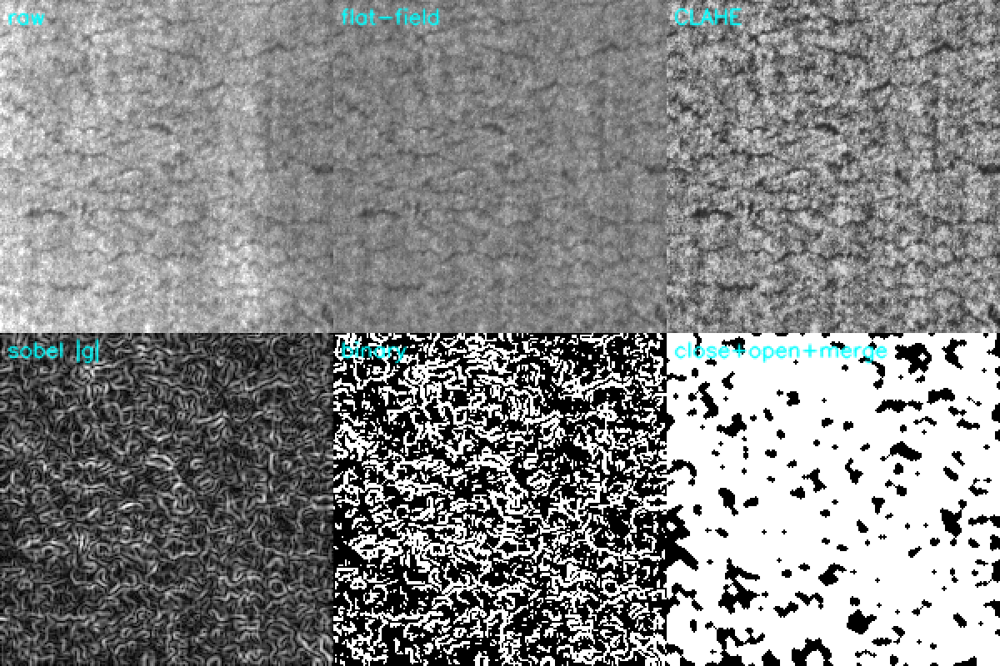
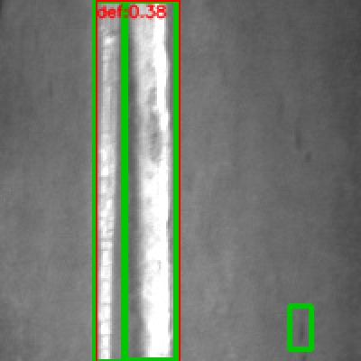
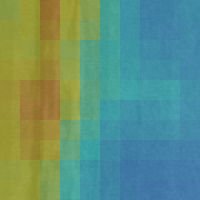
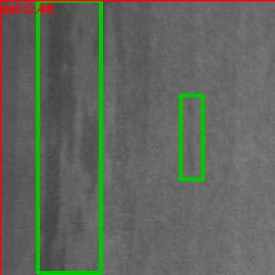

# 热轧带钢表面缺陷检测：传统图像处理基线 vs 滑窗小 CNN

NEU-DET 六类缺陷，两条**不依赖大模型**的检测路线，外加一个"定位交给传统方法、分类交给小 CNN"的 ROI 分类器，
全部用同一套工业口径（漏检率 / 过杀数 / 单图延迟）比较。

四个问题：

1. **传统图像处理能做到什么程度，哪几类缺陷是它注定做不到的？**
2. **滑窗 + 小 CNN 在真实数据上为什么打不过零训练的传统基线？**（结论和三个已查实的机制都在第 3 节）
3. **评估一个检测器，除了 mAP 还要看什么？**（漏检一条 = 一次质量事故；过杀一次 = 一次停机复核）
4. **只有分类网络能上现场时，怎么把活干完？**（ROI 分类：定位交给规则，语义交给 CNN）

结论：**在真实 NEU-DET 上，滑窗 CNN 的框级指标比传统基线差一个量级（mAP 0.006 vs 0.061），
但把任务换成"给定 ROI 判六类"后 CNN 能到 0.968。** 不是调参没调好，而是"固定窗口分类器不适合做定位"。

---

## 1. 数据

[NEU-DET](http://faculty.neu.edu.cn/yunhyan/NEU_surface_defect_database.html)（东北大学热轧带钢表面缺陷库）：6 类、共 1800 张 200×200 灰度图，VOC 格式标注。

```
data/NEU-DET/
├── IMAGES/        # *.jpg（1800）
└── ANNOTATIONS/   # *.xml（1800，VOC bndbox，共 4189 个框）
```

下载：数据集不在仓库里（37 MB）。官方入口是东北大学宋克臣/闫云辉的主页；
也可以从 Kaggle / Roboflow 上搜 "NEU-DET" 找到同源镜像，**只要 `IMAGES + ANNOTATIONS` 这一份**（不是 NEU-CLS）。

| 类别 | 含义 | 传统方法的难点 |
|---|---|---|
| crazing | 细密裂纹网 | 对比度极低，梯度阈值直接淹在噪声里（见第 3.2 节：召回 0.009） |
| inclusion | 条状夹杂 | 细长（31% 的框短边 < 48 px），与轧制方向纹理同向 |
| patches | 大面积斑块 | 面积大、边界模糊，和正常氧化皮同灰度 |
| pitted_surface | 密集麻点 | 小目标 + 数量多，连通域会被拆成一堆碎点 |
| rolled-in_scale | 氧化皮压入 | 边界抖动，形状不规则 |
| scratches | 划痕 | 方向和纹理相近，容易过杀 |

数据里两件必须先看清的事（它们决定了后面所有结论的边界）：

| 观察 | 数字 | 对评估的影响 |
|---|---|---|
| crazing 的框很大 | 最长边中位数 **130 px**（图只有 200 px） | 框内大部分像素其实是背景 → 滑窗的"中心点=正样本"标签会掺进大量噪声 |
| inclusion 的框很细 | **31% 的框短边 < 48 px**，最细约 14 px | 64 px 的窗口 + 32 px 的网格，天生定位不到 |
| 有 89 个框几乎覆盖整张图 | 其中 88 个是 pitted_surface | 框级 IoU 评估对这类标注天然不友好 |

没有数据也能跑通全流程：`scripts/run_all.py` 会先用合成数据（同样的六类、同样的 200×200、同样的 VOC 结构）把管线跑一遍。
**合成数据只证明管线正确，不代表真实精度** —— 下面所有数字都标了数据来源。

---

## 2. 三条路线

### A. 传统图像处理基线（零训练、零参数学习）

`src/preprocess.py` ：

```
灰度 → flat-field（大核中值做背景估计后相除，先干掉光照不均）
     → CLAHE（局部对比度拉伸，专门救低对比度缺陷）
     → 高斯（抑制传感器噪声，别让噪声变成边缘）
     → Sobel 幅值（缺陷的本质是局部灰度突变）
     → 阈值（Otsu 或分位数，二值化）
     → 闭运算（连断裂）→ 开运算（去孤立噪点）→ 膨胀（把同一缺陷的碎片并成一组）
     → 连通域 → 面积 / 填充率 / 长宽比 规则筛选
     → 输出框 + 分数（框内平均梯度 / 全图梯度 p99.5，用于阈值扫描）
```

参数不在 val 上调：`--mode tune` 只在 **tune 集**上网格搜索（72 组），best 参数落盘，val 只用来报数。

### B. 滑窗 + 小 CNN（`src/patches.py` → `src/cnn_model.py` → `src/slide_infer.py`）

把检测降维成 patch 二分类：

```
训练：按 GT 采样正/负 patch（含"贴着缺陷边缘"的 hard negative）→ 0.29M 参数的小 CNN
推理：滑窗打分（stride 可调）→ 分数热力图 → 阈值 → 连通域 → 合并 → NMS → 框
```

- 网络：3 个 conv block（每个 2 层 3×3 + BN + ReLU + MaxPool）+ 全局池化，0.29M 参数，**纯 CPU 可训可推**；
- 采样：每张图按 GT 框数分配正样本，负样本避开 GT 周围 0.5×patch 的环带（教模型学"缺陷 vs 干净背景"，而不是背景纹理）；
- 数据增强：翻转、±8° 旋转、亮度/对比度抖动、高斯噪声 —— 工业图像里"光照偏移"才是最真实的域偏移。

**为什么不用 YOLO？** 因为现场经常只有"分类网络能上"的条件（推理框架只支持分类算子、NPU 工具链限制、模型要过安全审查）。这条路线能把"算力受限"这个约束显式地摊在桌上：**精度换延迟，且延迟与窗口数成正比**。

### C. ROI 六分类（`src/train_cls.py`）—

定位交给规则/传统方法，CNN 只回答"这一小块属于哪类缺陷"：

```
GT 框往外扩 20% 作为 ROI（把缺陷周边的纹理上下文带进来）→ resize 96×96 → 小 CNN 六分类
```

这不是退而求其次：NIII 那类做工业质检的公司，产线上常见的就是"规则/小模型初筛 + 大模型或人工复判"，
**定位和分类本来就该分开优化**。第 3.4 节的数字说明这一步是有效的。

---

## 3. 结果（真实 NEU-DET，val 271 张 / 598 个框，IoU=0.5）

切分：train / tune / val = 1258 / 271 / 271，按主类分层。
**tune 只用来选参数，val 只用来报数**——同一份数据既调参又报数，等于自己骗自己。

### 3.1 主结果：滑窗 CNN 输给零训练的传统基线

| 方法 | mAP@0.5 | 召回 | 漏检率 | 图级漏检 | 过杀/图 | 预测框数 | 单图延迟 (avg) |
|---|---|---|---|---|---|---|---|
| **传统基线**（72 组网格搜索，零训练） | **0.061** | **0.199** | 0.801 | 0.649 | 2.04 | 671 | **18.9 ms** |
| 滑窗 + 小 CNN（stride 16, thr 0.3） | 0.0060 | 0.044 | 0.957 | 0.904 | 1.08 | 319 | 769 ms |
| 滑窗 + 小 CNN（stride 32, thr 0.3） | 0.0054 | 0.040 | 0.960 | 0.911 | 1.01 | 298 | 268 ms |

三条读法：

1. **传统基线的 0.061 也很低，但它的召回不是均匀的**：pitted 0.65、scratches 0.48、inclusion 0.28，
   而 crazing / patches / rolled-in_scale 基本为 0（3.2 节）。也就是说，"低 mAP"里其实有一半类别是能用的。
2. **滑窗 CNN 在 patch 级并不差**（val AUC 0.687、patch 召回 0.39 / 精确率 0.59），但**转不成框**：
   热力图是弥散的团块而不是尖峰（图 3），一个 130 px 的大缺陷会点亮一大片格子，连通域一合并就是"框偏大 + 漏细缺陷"。
3. **真正的分水岭是定位，不是分类**：同一批图、同样的 GT 框，小 CNN 做六分类能到 **0.968**（3.4 节）。
   所以问题不在"CNN 学不会缺陷"，而在"固定窗口 + 粗网格不是定位的正确工具"。

### 3.2 逐类召回：谁在拖后腿（同一份预测，按类别切 GT 统计）

| 类别 | GT 框数 | 传统基线 | 滑窗 CNN (s16) | 滑窗 CNN (s32) |
|---|---|---|---|---|
| crazing | 105 | 0.009 | 0.009 | 0.009 |
| inclusion | 139 | **0.281** | 0.000 | 0.000 |
| patches | 122 | 0.025 | 0.025 | 0.025 |
| pitted_surface | 57 | **0.649** | 0.210 | 0.193 |
| rolled-in_scale | 96 | 0.010 | **0.104** | 0.094 |
| scratches | 79 | **0.481** | 0.000 | 0.000 |

- **crazing 是共同的天花板**：105 个框两边都只捞到 1 个。图 1 解释了原因 ——
  CLAHE 之后 crazing 的梯度分布和轧制纹理完全重叠，二值图里约 50% 的像素是白的，任何阈值都切不出缺陷。
  这是**光学问题**：要低角度暗场/同轴光 + 更高分辨率，换模型没用。
- 传统方法赢在"高对比 + 有明确边界"的类别（pitted、scratches、inclusion）；滑窗唯一赢的一项是 rolled-in_scale（0.104 vs 0.010）。
- 两边都为 0 的类别（inclusion 对滑窗、scratches 对滑窗）不是"检测不到"，是**框的尺度永远对不上**：细长缺陷被格子离散化之后，IoU 到不了 0.5。

### 3.3 滑窗为什么输了：三个已经查实的机制（不是"调参不够"）

**① 标签里有系统性噪声。** GT 框的中位尺寸是 130 px，而窗口只有 64 px —— "窗口中心落在框内"就等于正样本，
于是一个 130 px 的大框内部会贡献大量**看上去是干净背景**的正样本。模型学到的是"暗一点的大片区域 = 缺陷"，
所以热力图是弥散的团块。把负样本边距从 0.5×patch 收紧到 0.3×patch 后，正负比从 57:43 变成 33:67，
AUC 从 0.66 升到 0.687 —— 方向对，但补不回结构性缺陷。

**② 框的几何上限（这条最硬）。** `tools/check_iou_ceiling.py` 穷举了"任意尺寸、任意位置的可达框"能拿到的最大 IoU：

| stride | IoU 中位数（完美热力图） | IoU < 0.5 的 GT 框占比 |
|---|---|---|
| 16 | 0.821 | **21.1%** |
| 32 | 0.690 | **19.2%** |

也就是说，**即使热力图完美预测每个格子的概率，也有约 1/5 的 GT 框在数学上到不了 IoU=0.5**。
它们是 14~22 px 的细长 inclusion。滑窗路线的 mAP 天花板就在这里。

**③ 容量和数据量都不够。** 0.288M 参数、250 张训练图、8 epoch（CPU 上一轮约 110 秒，全量 1258 张要跑几小时）。
64×64 的窗口看 crazing 这种纹理级缺陷，输入信息本身就不足。

> 结论：固定窗口分类器在"缺陷尺寸跨 14~200 px、框还经常贴边"的数据上，不是正确的定位工具。
> 正确做法是**检测器**（YOLO/SSD 之类有回归分支和多尺度特征）或**两阶段**（粗定位 → 局部细搜）。
> 实现了两阶段（`--fine-stride`，见 3.6），但它在 tune 和 val 上方向相反，所以默认关闭 —— 不宣称提升。

### 3.4 换任务：ROI 六分类能到 0.968

定位用 GT 框（模拟"规则/传统方法已经给出 ROI"的现场情况），CNN 只判类别：

| 指标 | 数值 |
|---|---|
| val 准确率 | **0.9682** |
| macro-F1 | 0.9677 |
| 参数量 | 0.288 M |
| 训练成本 | 2958 个 ROI，8 epoch，CPU 约 18 分钟 |
| 单 ROI 推理 | P50 **14.9 ms** / P95 17.4 ms（96×96，4 线程 CPU） |

逐类召回：crazing 1.000 / inclusion 0.878 / patches 0.992 / pitted 1.000 / rolled-in_scale 1.000 / scratches 0.987。
**最难的 crazing 在分类上一点不难（1.000），难的是"在整图上找到它在哪"** —— 这正好和第 3.2 节对上，
也是这个 demo 最想让人记住的一句话：*分类能力和定位能力是两件事，工业现场往往卡在后者*。

混淆矩阵（图 5）：主要错误集中在 inclusion → pitted（8 例）和 inclusion → patches（4 例），
三者都是"灰度相近的块状物"，和人工标注时边界不一致的直觉一致。

**联动关系**：ROI 分类的 0.968 是**上限**，建立在"定位正确"的假设上。
用传统基线的定位（召回 0.199）串起来，端到端能判对的框只有约 19.9% × 96.8% ≈ 19% —— 定位仍然是瓶颈。

### 3.5 精度-延迟（真实数据 60 张，4 线程 CPU，报告分位数而不是均值）

| 方法 | P50 | P95 | P99 | 说明 |
|---|---|---|---|---|
| 传统基线（全流程） | **5.06 ms** | 13.33 | 15.48 | 含 I/O 的平均是 18.9 ms |
| 滑窗 CNN，stride 32（36 窗/图） | 216.4 | 243.5 | 255.7 | 前向占 99.5%，后处理 0.6 ms |
| 滑窗 CNN，stride 16（100 窗/图） | 683.9 | 744.2 | 751.0 | 窗口数 ×2.8，延迟 ×3.2 |
| ROI 六分类（单 ROI，96×96） | 14.9 | 17.4 | — | 和定位串行，可 batch |

读法：**延迟≈线性于窗口数**，这是滑窗路线最有价值的一条工程结论；而传统基线的 5 ms 说明
"在能用的类别上，规则的性价比高得离谱"——这也解释了为什么产线上大量工位还在用规则 + 阈值。

### 3.6 合成数据（只用来验证管线，不作结论）

没有 NEU-DET 时，`scripts/run_all.py` 会在合成数据（72 张，同一套六类）上跑完整条管线。
这一阶段的数字只用来证明"管线正确、口径统一、结果可复现"：

| stride | 窗口数/图 | mAP@0.5 | 召回 | 延迟 |
|---|---|---|---|---|
| 8 | 324 | 0.186 | 0.33 | 4036 ms |
| 16 | 121 | 0.144 | 0.27 | 948 ms |
| 24 | 49 | 0.118 | 0.20 | 345 ms |
| 32 | 36 | 0.152 | 0.27 | 238 ms |

线程扫描：`threads=1 365.0 ms / 2 254.9 / 4 398.3 / 8 396.0` —— 2 线程最快，4/8 出现超订；
单图窗口太少时，线程同步开销超过并行收益，而且**小图上的延迟测量本身有 ±15% 噪声**。

两阶段细搜（`--fine-stride 8`）：粗网格出候选 → 候选框外扩 16 px → 框内细扫 → 分数加权质心定框 → 全局 NMS。
窗口数 36 → 120（比全图 stride 8 便宜 2.7 倍），但在合成数据上 tune 集 mAP 0.218 → 0.385、val 集 0.152 → 0.082，
**两个 split 方向相反**。样本量不足以支撑结论时，正确动作是不改默认值，而不是改到好看为止。

合成数据上传统基线效果更好，但也不代表方法优劣：合成生成器本身就是"阈值可分"的（高对比块 + 可加性噪声），
等于给路线 A 开了后门。**方法结论一律以第 3.1 节的真实数据为准。**

### 3.7 图（每条都能用第 7 节的命令重新生成）



**图 1**：真实 NEU-DET 的 crazing。上排 `raw → flat-field → CLAHE`，下排 `|Sobel| → 二值 → 闭+开+膨胀合并`。
raw 里缺陷几乎看不出结构；CLAHE 把对比度拉起来的同时把轧制纹理一起放大；二值图里约 50% 的像素是白的，
**传统方法在这一类上不是"参数没调好"，而是信噪比不够**。这就是第 3.2 节 crazing 召回 0.009 的证据。



**图 2**：同一条传统管线在 scratches 上的表现（绿=GT，红=预测）。主划痕抓得很准（这就是它 0.481 召回那一半），
旁边的小框是过杀，右侧那条细划痕漏了 —— **"能抓到主要缺陷 + 有稳定的过杀"正是规则方法在产线上的真实形态**。



**图 3**：64×64 窗口、stride 32 的分数热力图（inclusion）。注意它是**弥散的块**，不是一个尖峰：
模型响应的是"这一大片偏暗"，而不是"这条夹杂在哪里"。这是 3.3 ①（大框导致的标签噪声）的直接可视化。



**图 4**：同图的最终输出。框偏大、偏左，右侧那条真正的细夹杂完全没框住 ——
细长目标在 32 px 网格上只点亮一两个格子，连通域和 NMS 之后必然是这个结果。


**图 5**：ROI 六分类的混淆矩阵（val 598 个 ROI，acc 0.968）。错误几乎全部集中在 inclusion 与 pitted/patches 之间，
crazing、rolled-in_scale、pitted 都是满分 —— 和 3.4 节"分类不难、定位才难"的结论一致。

---

## 4. 排查链
> 四个 bug **都不报错**，只让指标莫名其妙地差。
> 排错顺序永远是"先怀疑标签和口径，再怀疑模型"——四次里有三次是标签/坐标的错。

### 4.1 滑窗标签口径返工两次：IoU → 覆盖率 → 中心点

| 版本 | 正样本规则 | patch 级 val AUC | 检测 mAP@0.5 |
|---|---|---|---|
| v1 | `IoU ≥ 0.35` | **0.45**（比随机还差） | — |
| v2 | 窗口内缺陷覆盖率 ≥ 5% | 0.97 | 0.11 |
| v3 | **窗口中心点落在缺陷内** | 0.957 | 0.152（合成）/ 0.006（真实） |

- v1 错在哪：缺陷常 80~120 像素，在缺陷**内部**裁 64×64 窗口，IoU 只有 0.3 → 被判负样本，模型学成"干净的背景才是缺陷"。
- v2 修好了分类，却引入了新问题（见 4.2）；而且覆盖率把"大缺陷内部的窗口"和"贴着缺陷的窗口"混为一谈。
- v3 为什么更对：滑窗输出的本质是"**这个格心在不在缺陷上**"，训练目标和推理语义必须一致。

> 教训：滑窗分类的上限主要由**标签口径 + 采样策略**决定，不是网络深度。
> 真实数据上 v3 也救不回 mAP（3.3 节），说明**口径只能修语义，修不了几何上限**。

### 4.2 出框尺度：`格心 ± patch/4` → `格心 ± stride/2`

v2 的 AUC 已经 0.97，检测 mAP 却只有 **0.11**。原因是出框直接拿"窗口左上角 + patch 尺寸"，
一个 40 像素的缺陷被画成 96×96 的框 —— **IoU 在数学上不可能超过 0.5**，mAP 再好的分类器也救不回来。

正确做法：一个亮格子代表"格心附近 `± stride/2` 的区域"，于是出框取**所有亮格心**的外接框再外扩半个步长。

同一次排查里还揪出一个纯代码 bug：`cv2.connectedComponentsWithStats` 返回的是 `[x, y, w, h, area]`，
我按 `[top, left, h, w]` 解包，导致切片行列颠倒、偶发空切片。它没有抛异常，只留下一条
`RuntimeWarning: Mean of empty slice` —— 顺手把这条警告当成了排查入口。

> 教训：**指标里的每个数字都要能和代码里的一行对应上**。说不清框是怎么算出来的，mAP 就没有意义。

### 4.3 膨胀只用来分组，出框要用原始掩膜

第一版直接拿"膨胀后的连通域"算外接框，框系统性偏大，IoU 被吃掉一大截，tune 集 F1 只有 0.389。
改成"分组看膨胀结果、出框看 `膨胀 ∩ 原始掩膜`"后 F1 → 0.414。
（数字不大，但体现的是同一条排查顺序：**指标难看先怀疑方法学，而不是先换模型**。）

### 4.4 VOC 的 1-based 端点：每个框小 1 像素

`xmax` 是含端点的 1-based 坐标，正确换算是 `[xmin-1, xmax)`。早先两边都减 1，每个框窄 1 像素 ——
对 20 像素的小目标等于白丢 10% 的 IoU，而且**不会报错**。现在有测试守着（`tests/test_basic.py`）。

---

## 5. 失败记录

| 现象 | 根因 | 该改哪里 |
|---|---|---|
| crazing 整类漏检（105 框、召回 0.009，两条路线都一样） | 裂纹梯度与轧制纹理完全重叠，二值图 50% 白（图 1） | **光学**：低角度暗场/同轴光、更高分辨率；算法侧换纹理类方法（PatchCore/PaDiM），不是换阈值 |
| inclusion 召回 0.281，且 31% 的框短边 < 48 px | 细长目标在网格上只占 1~2 格，闭运算又把两端吃掉 | 各向异性形态学 / 定向滤波；或用 ROI 分类替代定位 |
| patches 召回 0.025 | 斑块与正常氧化皮同灰度，梯度没有边界 | 需要彩色/多光谱或更高对比度；梯度类特征无解 |
| pitted 有 88 个框几乎覆盖整图 | 标注把整张图框住，框级 IoU 评估天然吃亏 | 改成图像级"有/无" + 热力图定位，别强求 IoU |
| 过杀 2.04 框/图 | `min_area=120`、`merge_k=3` 在批次之间漂 | 按批次重标定 + 难例回流 + 稳定的光源 |
| 滑窗热力图弥散、框偏大 | 大框（130 px）内部被当成正样本（3.3 ①） | 换检测器；或把正样本限制成"缺陷的边界带" |

---

## 6. 局限

- 只在一份数据（NEU-DET，1800 张 200×200）上验证，**没有跨批次/跨产线的泛化实验**；真实产线换钢种、换光照都要重新标定；
- 延迟是 PyTorch CPU 实测，**没有 TensorRT/OpenVINO/RKNN 的量化加速数字**，不编；
- 传统基线的参数是网格搜索得到的（tune 集 72 组），产线上必须按批次重新调，否则一周就漂；
- 滑窗路线的 mAP 天花板被 stride 锁死（3.3 ② 的 IoU 上限表），**加数据、加 epoch 都不会改变这个上限**；
- 两阶段细搜在 tune/val 上方向相反，默认关闭 —— 不是没想到，是不敢在 271 张 val 上下结论；
- ROI 分类用的是 GT 框，属于"定位正确"的上限估计，端到端会掉到 ~19%（3.4 末）；
- 没有做 3D 视觉、没有用 ROS、没有 Jetson 上板实测（这三条正好是 NIII JD 的加分项，我目前是缺的）。

---

## 7. Quick Start

```bash
pip install -r requirements.txt          # CPU 版 torch 就够（实测 torch 2.0.1+cpu）

# 一键（没有真实数据会自动生成合成数据，全流程约 10 分钟）
python scripts/run_all.py

# 用真实 NEU-DET（解压成 data/NEU-DET/IMAGES/*.jpg + ANNOTATIONS/*.xml）
python scripts/run_all.py data/NEU-DET
```

分步跑（真实数据上的推荐顺序）：

```bash
python -m src.make_splits    --data-root data/NEU-DET --out data/splits.json      # 1258/271/271
python -m src.trad_baseline  --data-root data/NEU-DET --mode tune                 # 只在 tune 集选参
python -m src.trad_baseline  --data-root data/NEU-DET --mode eval --split val     # val 报数
python -m src.train_cnn      --data-root data/NEU-DET --epochs 8 --threads 4      # patch 二分类
python -m src.slide_infer    --data-root data/NEU-DET --which-split val --stride 16 --thr 0.3
python -m src.train_cls      --data-root data/NEU-DET --epochs 8                  # ROI 六分类（0.968）
python -m src.evaluate       --preds results/trad/preds_val.json results/cnn_s16/preds_val.json \
                             --labels trad slide16 --data-root data/NEU-DET --split val
python -m tools.per_class_recall --preds results/trad/preds_val.json --label trad  # 逐类召回
python -m src.bench_latency  --data-root data/NEU-DET --limit 60 --stride 16      # P50/P95/P99
python -m tests.test_basic                                                        # 9 项自测
```

可视化（预测框、预处理各阶段、滑窗热力图、混淆矩阵）：

```bash
python -m src.trad_baseline --mode draw --draw-n 6      # 每类各挑一张，不是只画前 6 张
python -m src.slide_infer   --mode draw --draw-n 6 --stride 16 --thr 0.3
python -m tools.plot_confusion --metrics results/cls/metrics.json --out docs/figs/05_cls_confusion.png
python tools/inspect_grid.py                            # 单图"热力图 + 出框"叠加，调参时用
```

> 模块用相对导入，必须 `python -m src.xxx`；直接 `python src/xxx.py` 会报 ImportError。

---

## 8. 目录

```
src/
  common.py         VOC 1-based → 0-based、分层切分、IoU/NMS、mAP、统一评估口径
  preprocess.py     传统图像处理管线（每一步都能单独调参）+ 手工特征
  trad_baseline.py  传统路线入口：tune / eval / classify / draw
  patches.py        滑窗采样与标签口径（中心点正样本）、PatchDataset、滑窗枚举
  cnn_model.py      0.29M 参数小 CNN（num_classes=1 时是二分类，=6 时是 ROI 分类器）
  train_cnn.py      patch 级训练 + 按 val AUC 选模型（不用 accuracy，因为正负不平衡）
  slide_infer.py    热力图 → 阈值 → 连通域 → NMS，含阈值/stride 扫描与两阶段细搜
  train_cls.py      ROI 六分类（本仓库唯一"能上产线"的那条路线，val acc 0.968）
  evaluate.py       多条路线统一出表（mAP / 最差类 AP / 漏检 / 过杀 / 延迟）
  bench_latency.py  P50/P95/P99 分段计时 + 线程数扫描
  viz.py            预测框、预处理中间图、热力图、按类挑图
  make_fake_data.py 合成 NEU-DET（只为跑通管线）
configs/
  trad_default.yml / cnn_default.yml   默认参数与搜索空间的文档（代码默认值以 CLI 为准）
scripts/
  run_all.py / run_all.sh / quickstart.sh
tools/
  inspect_grid.py      单图热力图+出框调试
  check_iou_ceiling.py 穷举可达框的 IoU 上限（3.3 ② 那张表的来源）
  per_class_recall.py  逐类召回表（3.2）
  plot_confusion.py    ROI 分类混淆矩阵（图 5）
tests/
  test_basic.py        9 项自测：VOC 口径、IoU/NMS、切分确定性、中心点标签、出框尺度、细搜铺满、传统基线能找到明显缺陷、按类挑图不重复
docs/figs/             README 用的 5 张图（都能用第 7 节的命令重新生成）
```

---

## 9. 评估

| 指标 | Why |
|---|---|
| mAP@0.5 | 通用对比用，但**不能单独作为验收指标**（本仓库就是反例：0.006 和 0.061 都很难看，可用性却完全不同） |
| 最差类 AP / 逐类召回 | 六类里崩一类（crazing）就够让产线漏一批货，平均值会掩盖它 |
| 漏检率 / 图级漏检 | 漏检=缺陷流出，是最贵的错误 |
| 过杀 FP/图 | 过杀=停机复核，决定这条线能不能用（人一天能复核多少张） |
| 单图延迟 P50/P95 | 产线节拍看 P95，不看均值；均值会被少数快图骗 |
| 定位召回 × 分类准确率 | 两条串联的链路，端到端上限是乘积（3.4 末） |

---

## 10. 参考

- NEU-DET 数据集：东北大学，Yan Yunhui 等，*Surface defect database*
- 传统管线参数：CLAHE (Zuiderveld, 1994)、Otsu (1979)、Canny (1986)
- 标签/采样口径对滑窗检测的影响：patch 分类器的正负采样规则决定了热力图语义
- 量化/部署背景：TensorRT / OpenVINO 官方文档（本仓库**没有**做量化实测，延迟均为 PyTorch CPU）
